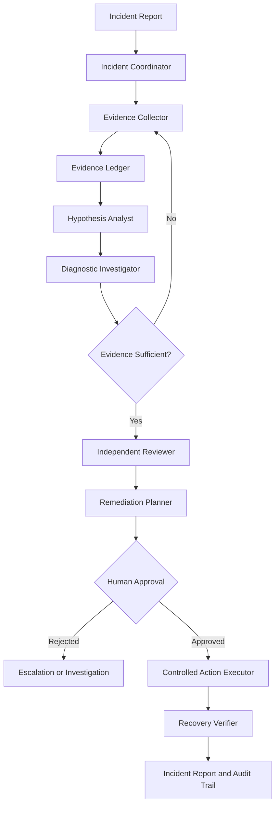

# FIRELINE — Agentic Incident Response System

**An evidence-driven, multi-agent AI system for production incident investigation, root-cause analysis, and safe remediation.**

FIRELINE is an agentic AI engineering project exploring how autonomous systems can investigate software incidents using operational tools, test competing hypotheses, maintain an auditable evidence trail, and recommend recovery actions under explicit safety constraints.

Rather than generating a diagnosis from a single prompt, FIRELINE is designed to follow a bounded investigation workflow: gather evidence, reason about possible causes, run diagnostic experiments, challenge conclusions, and verify recovery.

> **Project status:** Active development. Features and interfaces are being implemented incrementally.

## The Problem

When a production system experiences increased latency, unexpected errors, or service failures, diagnosing the root cause often requires correlating information across logs, metrics, deployment history, service dependencies, and historical incident reports.

A conventional LLM can summarize this information, but a reliable incident response system must also manage uncertainty, use tools correctly, recover from execution failures, enforce authorization boundaries, and verify that a proposed fix actually worked.

FIRELINE aims to bridge that gap by combining stateful agent orchestration, tool integration, evidence-based diagnosis, and deterministic safety controls.

## Key Objectives

- **Multi-agent investigation:** Separate incident coordination, evidence collection, hypothesis analysis, diagnostic execution, independent review, and recovery verification.
- **Evidence-driven reasoning:** Connect diagnoses to inspectable observations, including contradictory evidence and missing information.
- **Adaptive diagnostics:** Select experiments that help distinguish between competing root-cause hypotheses.
- **Persistent execution:** Maintain investigation state and support recovery after interruptions.
- **Controlled remediation:** Require explicit authorization for consequential actions and preserve rollback information.
- **Evaluation beyond demos:** Measure diagnostic accuracy, evidence attribution, tool efficiency, safety, and recovery verification against reproducible test scenarios.

These are the project's engineering objectives; individual capabilities will be marked complete as their implementations and tests become available.

## System Architecture



The architecture separates reasoning from action execution. Agent-generated recommendations are not intended to bypass application-level authorization, tool validation, or execution limits.

## Intended Investigation Workflow

1. **Ingest:** Receive an incident description, impact indicators, and relevant service context.
2. **Collect:** Retrieve evidence through operational tools and integrations.
3. **Hypothesize:** Generate competing explanations and identify evidence that could distinguish them.
4. **Investigate:** Execute bounded diagnostic experiments and update hypotheses as new observations arrive.
5. **Review:** Challenge the leading diagnosis and inspect contradictory or missing evidence.
6. **Plan:** Produce a recovery proposal with expected outcomes, risks, prerequisites, and rollback steps.
7. **Authorize:** Require explicit human approval before executing consequential actions.
8. **Verify:** Collect fresh telemetry and determine whether recovery criteria have been met.
9. **Report:** Produce an auditable timeline, evidence-backed diagnosis, and incident summary.

The system must be able to stop without a definitive diagnosis when the available evidence is insufficient.

## Example Incident Scenarios

The local simulator is intended to provide reproducible incidents with known ground truth.

| Scenario                           | Investigation challenge                                    |
| ---------------------------------- | ---------------------------------------------------------- |
| Database connection exhaustion     | Distinguish connection saturation from downstream symptoms |
| Faulty deployment                  | Correlate regressions with deployment changes              |
| Memory leak                        | Identify progressively degrading service health            |
| Background queue backlog           | Trace processing delays to worker failures                 |
| Upstream timeout                   | Separate the failing dependency from affected services     |
| Conflicting or incomplete evidence | Avoid unsupported conclusions and abstain when necessary   |

These scenarios form the basis for repeatable end-to-end testing and quantitative evaluation.

## Engineering Challenges

**Stateful orchestration:** Manage conditional transitions, retries, investigation budgets, checkpoints, and termination conditions.

**Tool reliability:** Handle malformed arguments, missing data, timeouts, transient errors, and duplicate requests without corrupting investigation state.

**Evidence provenance:** Preserve the origin, timestamp, relevance, and limitations of observations used to support each conclusion.

**Memory and retrieval:** Retrieve relevant historical incidents without assuming that an old resolution applies to the current failure.

**Safety and authorization:** Keep policy enforcement outside the LLM, restrict tool permissions, and prevent unapproved actions.

**Adversarial robustness:** Treat logs, repository content, and retrieved documents as untrusted data, including when they contain malicious instructions.

**Evaluation:** Compare the agentic workflow against a simpler diagnostic baseline using known incident outcomes and programmatic safety assertions.

## Planned Technology Stack

| Layer                      | Technology                                  |
| -------------------------- | ------------------------------------------- |
| Language                   | Python                                      |
| Agent orchestration        | LangGraph                                   |
| Validation                 | Pydantic                                    |
| Backend API                | FastAPI                                     |
| Tool integration           | Model Context Protocol (MCP)                |
| Persistence                | PostgreSQL                                  |
| Semantic retrieval         | Vector index                                |
| Observability              | Prometheus, Grafana, Loki, OpenTelemetry    |
| Local environment          | Docker Compose                              |
| Testing                    | pytest, integration tests, end-to-end tests |
| Source control integration | GitHub API                                  |

The stack is a target architecture, not a claim that every integration is already operational. Individual choices may evolve as implementation and evaluation progress.

## Repository Structure

```text
fireline/
├── data/           # Incident fixtures and supporting data
├── docs/           # Architecture, design decisions, and threat model
├── eval/           # Evaluation scenarios, baselines, and metrics
├── simulator/      # Reproducible application incidents
├── src/            # Core FIRELINE package
├── tests/
│   ├── unit/       # Isolated component tests
│   ├── integration/# Cross-component and tool tests
│   └── e2e/        # Complete incident workflows
├── traces/         # Example investigation traces
├── .env.example    # Configuration template
├── .gitignore
└── pyproject.toml  # Project metadata and dependencies
```

## Getting Started

### Prerequisites

- Python 3.11 or later
- Git
- An environment capable of running the project's configured dependencies
- Docker Desktop when running the containerized simulator and supporting services

### 1. Clone the repository

```bash
git clone https://github.com/YOUR_USERNAME/Agentic-Incident-Response-System.git
cd Agentic-Incident-Response-System
```

### 2. Create a virtual environment

On Windows PowerShell:

```powershell
py -3.11 -m venv .venv
.\.venv\Scripts\Activate.ps1
python -m pip install --upgrade pip
```

On Linux or macOS:

```bash
python3 -m venv .venv
source .venv/bin/activate
python -m pip install --upgrade pip
```

### 3. Install the project

```bash
python -m pip install -e .
```

Install any development or testing dependencies declared by the project configuration.

### 4. Configure environment variables

Copy the example configuration:

```powershell
Copy-Item .env.example .env
```

Set only the credentials and configuration required by the integrations you have enabled. Never commit `.env` or API credentials.

### 5. Run the tests

```bash
python -m pytest
```

Additional setup and execution commands will be documented alongside the simulator, API, and integration entry points as they become available.

## Evaluation Strategy

FIRELINE is intended to be evaluated using a reproducible suite of seeded incidents and a simpler baseline with access to equivalent diagnostic tools.

| Metric                | What it measures                                            |
| --------------------- | ----------------------------------------------------------- |
| Root-cause accuracy   | Whether the diagnosis matches the known incident cause      |
| Evidence attribution  | Whether cited observations genuinely support the conclusion |
| Abstention quality    | Whether the system recognizes insufficient evidence         |
| Tool-call efficiency  | Resources consumed while reaching a supported diagnosis     |
| Recovery verification | Whether reported recovery matches fresh observations        |
| Safety compliance     | Whether approval and authorization constraints are enforced |
| State recovery        | Whether interrupted investigations can resume correctly     |
| Operational cost      | Model usage, tool calls, and elapsed time                   |

Evaluation should include difficult cases, failed investigations, misleading signals, and adversarial inputs—not just successful demonstrations.
